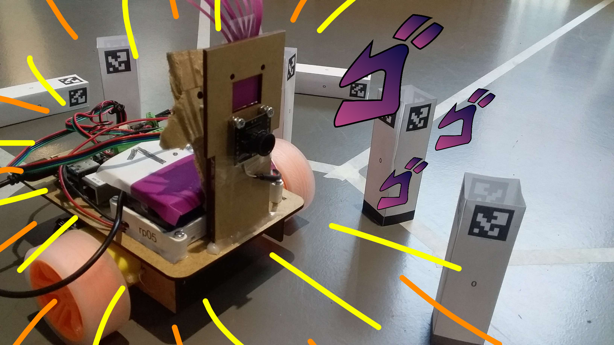

## Note
This repository is a copy that serves as a showcase for a project I worked on. I was in charge of the logic and movements of the robot as well as the requests with the telemetry reporting. However my contributions went beyond these areas as I helped fix multiple issues (see suivi.md for more details).
Teammates have been anonymized and some files have been translated.

# Group 1 team 5
Tom Dugail, Teammate_1, Teammate_2, Teammate_3

# Setting up the robot (dev mode)
- Start an SSH connection
- Go to `~/project/team5`
- Run `git pull`
- Make sure you're on the correct branch
- If the `venv` folder doesn't exist:
    - Run `python3 -m venv venv`
    - Install the modules:
        - `pip install flask`
        - `pip install flask_socketio`
        - `pip install smbus`
        - `pip install asyncio`
        - `pip install “opencv-contrib-python==4.6.0.66”`
        - `pip install numpy==1.26.4`

## Starting the robot
- Run `./start.sh`
- Access the web interface at `137.194.173.15:5000`

## Running the tests
### Movement test
The test performs:
- a calibration
- a movement toward beacon 2
- a left/right calibration test
    - a spin in place
    - a check of the angle relative to beacon 2
- a forward/backward calibration test
    - a backward movement
    - a check of the distance to beacon 2
The test results are displayed on the console
To run it:
`python3 /tests/test_controle.py`

### Tracking Server Test
The test performs the following:
- Sends the position and angle specified by the user to the tracking server
Returns a success if the request was processed successfully, if an error originated from the server, or if
the request is valid but the test has not yet started. Otherwise, returns an error
To run it:
`python3 /tests/test_pos.py X Y alpha`

## Software architecture

The robot has four main modules: web, control, camera, and battery.

The user communicates with the robot through the web interface.
This interface sends WebSocket requests to the Flask server.
The Flask server makes synchronous or asynchronous calls to the robot’s Python code (using `async`).

To integrate the common strategy, commands from the group’s shared server are routed through the `puppet.py` file in the control module.
This file ensures consistency between the basic tasks required by the common strategy and the team’s corresponding implementation.

Translated with DeepL.com (free version)